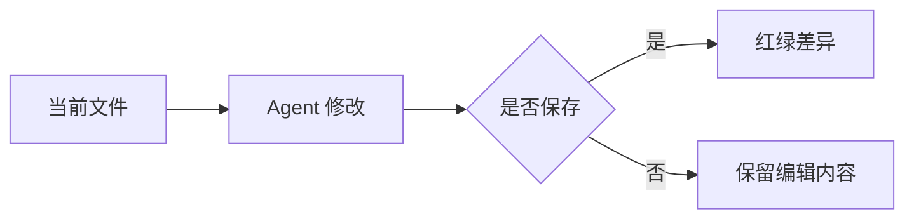
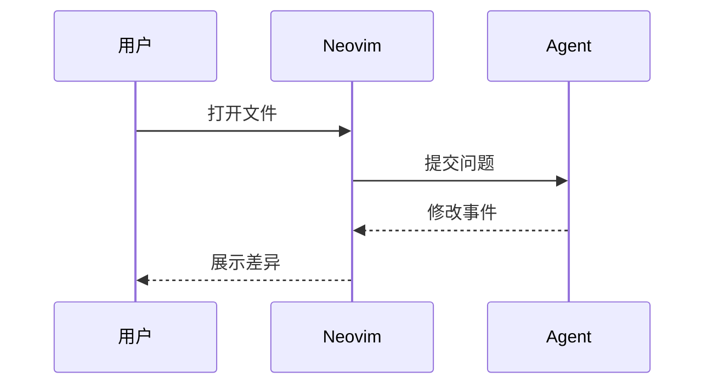

# Markdown 与 Mermaid 图形

正文、标题、表格仍由 `render-markdown.nvim` 排版；Mermaid 代码块由已有的 `snacks.nvim` 图像模块调用官方 `mmdc` 生成 PNG，再通过 Kitty 图形协议显示。源 Markdown 不会被替换，也不提交生成图片。

在 Ghostty/Kitty 中打开 Markdown，正常阅读时显示图形，光标移入图块可查看或编辑源代码。保存后会更新。光标位于图块时可按 `<leader>mp`（空格 `m p`）或执行 `:MermaidPreview` 打开浮动预览；这个映射仅在 Markdown buffer 生效。

示例：把光标移到图块外观察图形。





## 依赖与安装

需要 Node.js/npm、Mermaid CLI、Chromium/Chrome 和 ImageMagick。本机已安装 Mermaid CLI 与 ImageMagick；浏览器优先复用已有缓存。其他机器可按需安装：

```sh
# macOS 的图像工具；其他系统使用对应包管理器安装 ImageMagick。
brew install imagemagick

# 只为 Neovim 安装，不污染全局 npm。默认同时下载 Puppeteer 浏览器。
npm install --prefix "${XDG_DATA_HOME:-$HOME/.local/share}/nvim/mermaid" @mermaid-js/mermaid-cli
```

已有 Chrome/Chromium 时可在 npm 命令前加 `PUPPETEER_SKIP_DOWNLOAD=true`。配置会搜索系统 Chrome、`PUPPETEER_EXECUTABLE_PATH`、Playwright/Puppeteer 的常见浏览器缓存；自定义位置可在启动 Neovim 的环境中设置 `PUPPETEER_EXECUTABLE_PATH`。路径按机器检测，生成的 Puppeteer 设置只写入 Neovim 缓存目录。

CLI 的本地 `.bin` 只加入 Neovim 的 PATH，不改 shell 配置。Mermaid 使用当前明暗主题生成透明背景图；主题切换后已有图像缓存可能不会立即刷新，必要时重启 Neovim。图像与转换结果存于 Snacks 缓存，不写入 Git 项目。

## tmux 与排查

Ghostty 和 Kitty 支持所需图形协议；tmux 需要允许透传，Snacks 会尝试设置当前窗格的 `allow-passthrough`。仍无法显示时，在 tmux 命令中检查/开启：

```sh
tmux show-options -p allow-passthrough
tmux set-option -p allow-passthrough on
```

运行 `:checkhealth snacks` 检查终端、Tree-sitter、`mmdc` 与 `magick`。图块需使用三个反引号加 `mermaid`，并且 Mermaid 语法正确；普通文本终端、不支持图形透传的远程链路或未安装依赖的机器只能显示源码。浮动预览也需要图形协议，不能替不支持图形的终端增加图片能力。

这里针对 Markdown buffer，不能渲染 Codex/Claude 原生 TUI 输出中的 Mermaid。Snacks 的隐藏源码功能仍属实验性；显示异常时可临时执行 `:lua Snacks.image.config.doc.conceal=false`，重新打开文件，让源码和图形一起显示。

参考：[Snacks image](https://github.com/folke/snacks.nvim/blob/main/docs/image.md)、[Mermaid CLI](https://github.com/mermaid-js/mermaid-cli)。
